# Folio

[](https://github.com/sreenivasivbieb/folio/actions/workflows/ci.yml)

**Drop your files, say what they are, and find everything later.**

Folio is a private, local-first desktop workspace for **Windows and Linux** (including
Omarchy/Arch). You drop in files or a whole project folder and describe them in your own
words, by typing or speaking. Folio then organizes them into a project with folders, tags,
people and dates, and links everything into a searchable knowledge graph. Every fact
points back to the file and line it came from.

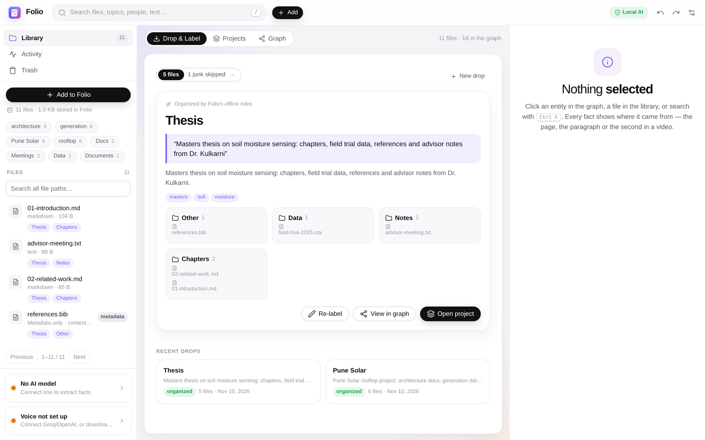

<p align="center">
  <b>Drop → Label (voice or text) → AI organizes → Graph &amp; Search</b>
</p>

- **Your files stay on your machine.** Everything lives in private local files. There is
  no Folio account, no Folio server and no database to run.
- **AI is optional.** Offline rules organize your drops with no network at all. You can
  also connect a local model (Ollama) or a hosted provider with your own API key.
- **Nothing is final.** You can re-label any drop, and Ctrl+Z undoes any action,
  including organizing.

## Watch the demo

[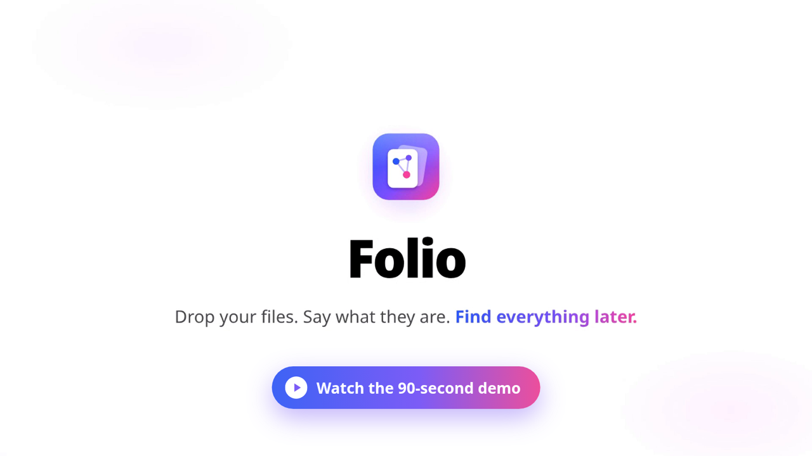](docs/media/folio-launch.mp4)

A 90-second walkthrough of dropping a folder, labelling it, the organized project, the
graph, search and the evidence viewer. Click the image to play it, or
[download the MP4](docs/media/folio-launch.mp4?raw=true).

**Contents:** [Demo](#watch-the-demo) · [Tour](#a-tour-of-folio) · [Shortcuts](#keyboard-shortcuts) ·
[Install](#install) · [First drop](#your-first-drop) · [Supported files](#supported-files) ·
[Data &amp; privacy](#your-data-and-privacy) · [AI &amp; voice](#choose-your-ai-and-voice) ·
[Backups](#backups-and-exports) · [How it works](#how-it-works) ·
[Development](#development) · [Troubleshooting](#troubleshooting-and-current-limits) ·
[Team](#team)

---

## A tour of Folio

> The screenshots below use made-up demo files, organized by Folio's **offline rules**
> with no AI model connected. A connected model writes richer summaries and folder names.

### 1. Drop

The **Drop &amp; Label** screen is the home screen. Drop files or a project folder anywhere
on the window, or use **Choose files** / **Choose a folder**. Folio never scans your
computer: it only sees what you give it. It shows how many files it will add, skips junk
(`node_modules`, `.git`, build output, lockfiles, binaries…) and lets you pick:

- **Move**: the files then live only in Folio's private vault, so nothing takes up disk
  space twice.
- **Copy**: your originals stay where they are.

Files that are already in Folio are recognized by their content and reused, not
duplicated.

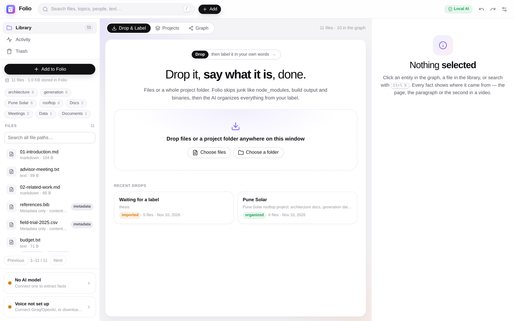

### 2. Label it in your own words

Say what the files are. Type it, or **hold to speak** in English, Hindi or Hinglish
(hold Ctrl+Space). Your spoken words go into the box first, so you can fix a misheard
name before anything happens. Press **Organize with AI** (or Ctrl+Enter).

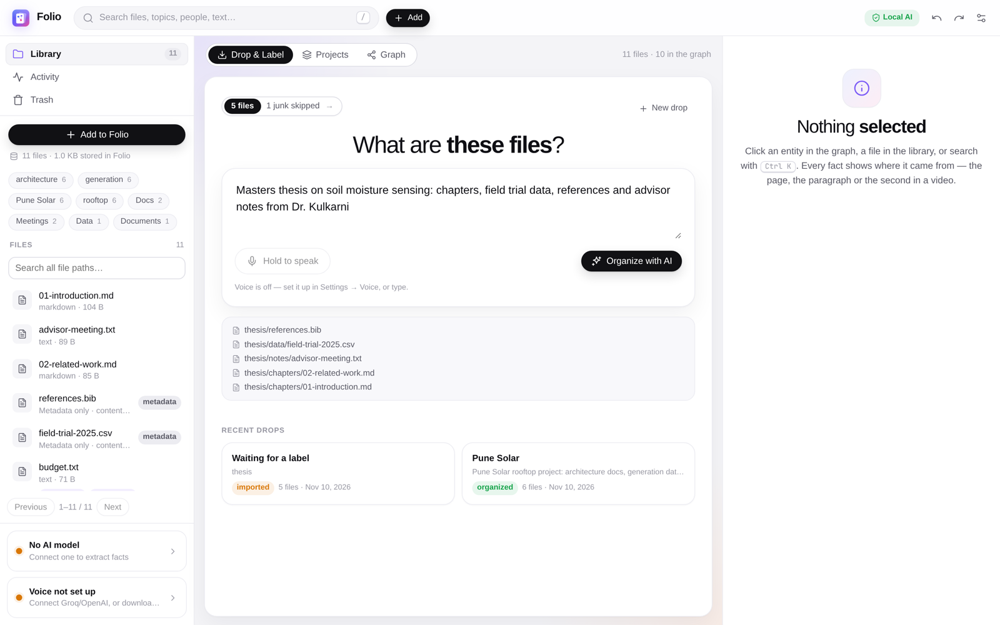

### 3. Folio organizes it

From your label, the file names and the first lines of each file, Folio creates:

- a **project** with a short **summary**,
- **folders** that group the files (every file lands in exactly one),
- **tags** (topics),
- the **people**, **organisations** and **dates** you mentioned. Dates also appear on
  timelines.

Each of these facts cites the files it came from. **Re-label** at any time to replace
the organization. Ctrl+Z undoes it, and the drop goes back to waiting for a label.

### 4. Projects

Every organized drop becomes a project. A project shows your original label (as you
said it), the summary, the people and tags, and the files grouped by folder.

**Show in graph** and **Timeline** open the project in those views.
**Preview &amp; organize on disk** (available for *Copy* drops of a single folder) shows
exactly how the original files would be rearranged into those folders. Nothing moves
until you confirm, and the move can be undone.

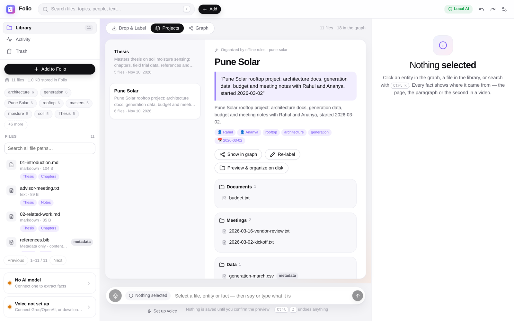

### 5. Graph

The graph links projects, folders, files, people and topics. You can:

- show **Everything** or only what is **Around** the current selection,
- **Focus on** one project, person or tag,
- **Highlight** nodes by name,
- toggle **Show files**.

Click a node to open its card on the right: what kind of thing it is, its files, and
every fact about it. Each fact shows a confidence score and links to the exact
passages that support it.

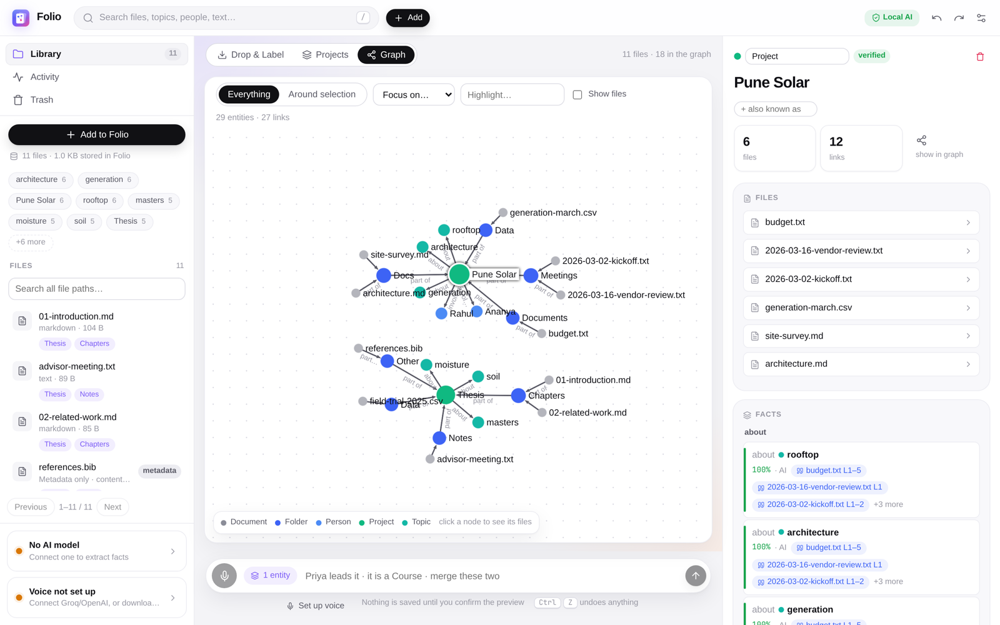

### 6. Swimlane and Timeline

Dated facts, such as when a project started, a meeting date or a deadline, appear on two
time views:

- **Swimlane** (`4`): one lane per entity (or per type), with every dated fact placed
  along a shared time axis. Drag a chip sideways to change its date, or onto another
  lane to move the fact to that entity. Both are ordinary edits, so Ctrl+Z undoes them.
  Verified facts have a green border; proposed ones are dashed.
- **Timeline** (`5`): everything dated about one project, person or topic, month by
  month, with links to its sources. Open it from a project's **Timeline** button, from
  the **timeline** button on any entity card, or select something and press `5`.

Dates in your labels (e.g. *"…started 2026-03-02"*) land here automatically.

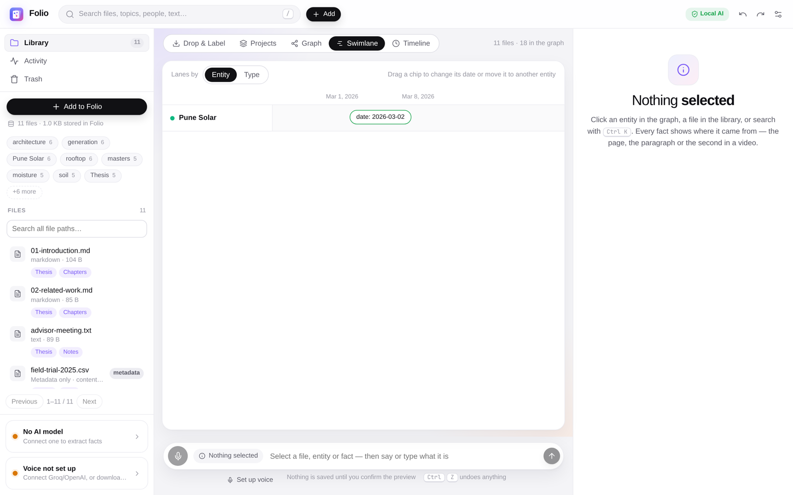

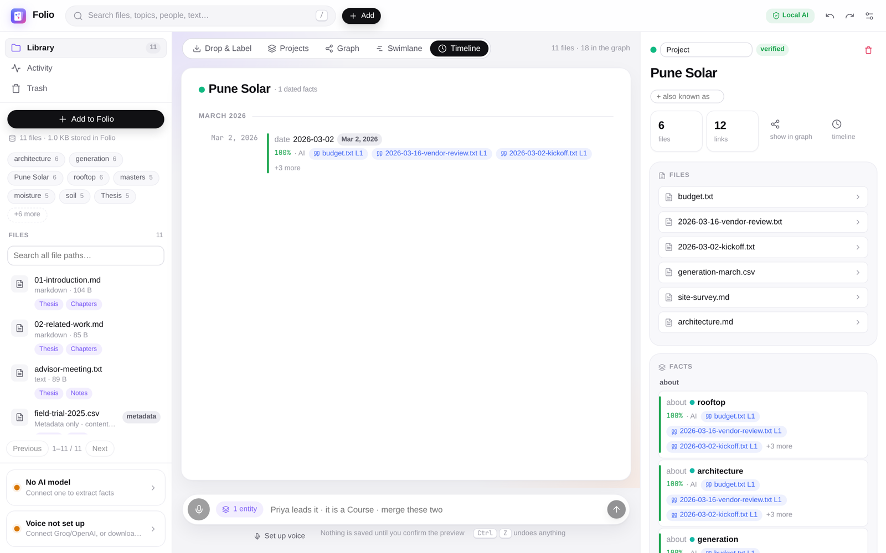

### 7. Search everything

Press `/` or Ctrl+K and type. Results come in this order:

1. your labels and project summaries,
2. project, tag, person and file names (typos and partial words are fine),
3. exact passages inside your files, with page numbers, line numbers or audio/video
   timestamps.

Search combines keyword matching (SQLite FTS5) with vector similarity.

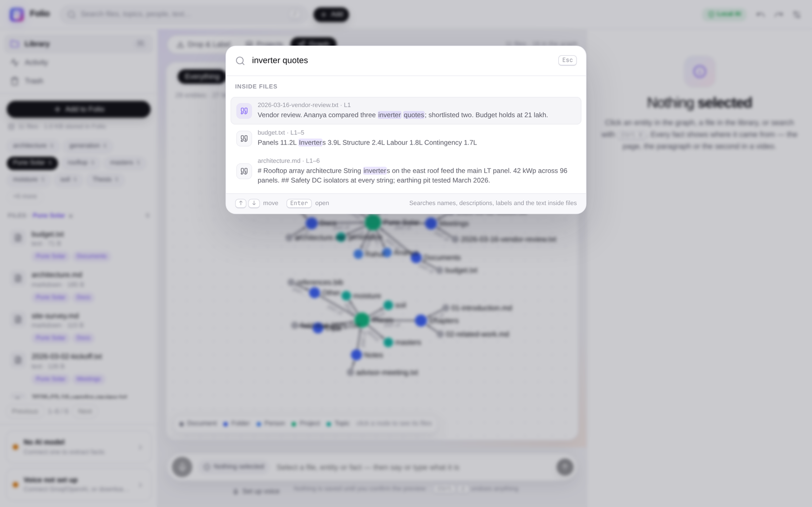

### 8. See where everything came from

Open a result, or any piece of evidence, and the **evidence viewer** shows the quoted
span in its file: the line, page, image region or moment in a recording.

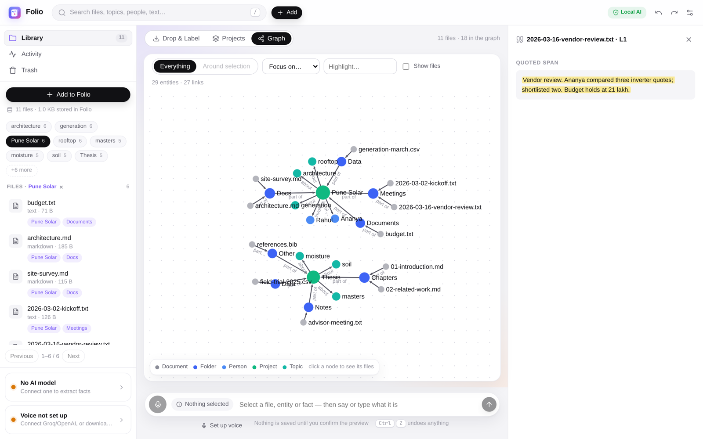

### 9. Library, activity and trash

The left sidebar holds:

- **Library**: every file, with its project and folder tags. Filter by clicking a tag,
  or search by file path.
- **Activity**: background work such as imports, indexing and transcription, with
  progress, errors and **Retry**.
- **Trash**: removed files, which you can **restore**, delete permanently, or empty
  all at once. Trashed files never appear in search.
- **Add to Folio**, plus status cards showing whether an AI model and voice are set up.

You can also export a stored file back to a folder on your computer.

The bar at the bottom of the window lets you describe whatever is selected, by voice or
text, for example *"Priya leads it"*, *"it is a Course"* or *"merge these two"*. You
always see a preview first, and one Ctrl+Z undoes it.

### 10. Light or dark

Folio has a light theme (the default), a dark theme, or it can follow your system
(**Settings → Appearance**).

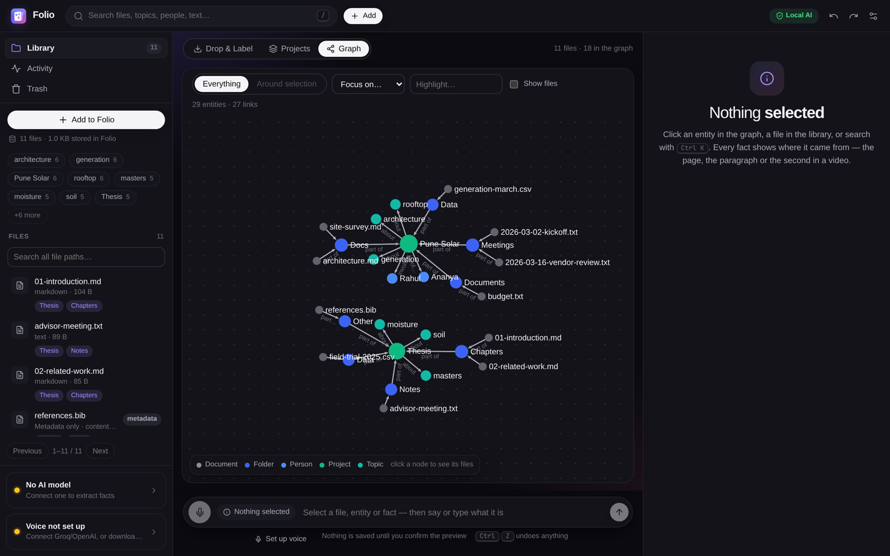

### 11. Settings

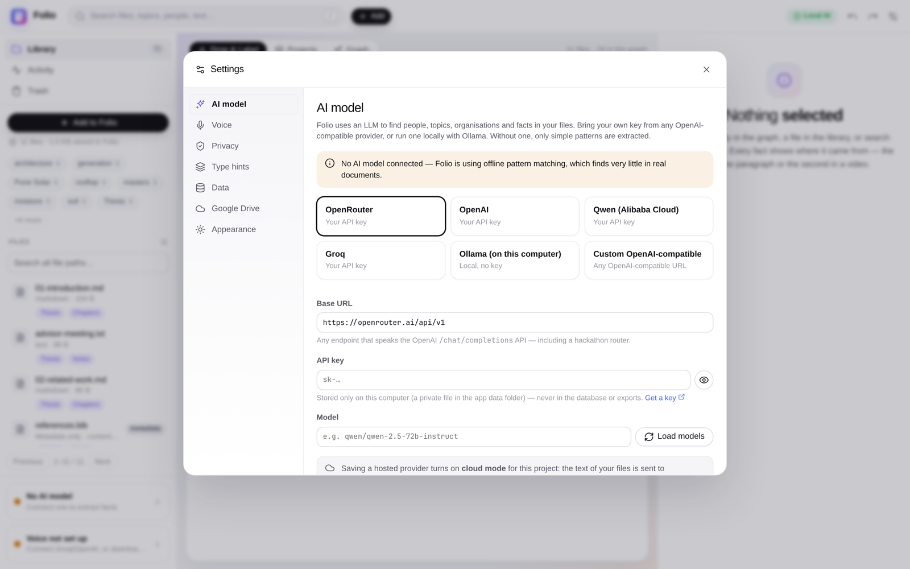

| Tab | What it controls |
| --- | --- |
| **AI model** | Offline, Ollama, OpenRouter, OpenAI, Qwen, Groq or any OpenAI-compatible URL: key, model list, **Test** |
| **Voice** | Speech through your provider's Whisper, or the offline speech model (~480 MB, downloaded once); push-to-talk setup |
| **Privacy** | Cloud processing on/off, shown as **Local AI** / **Cloud AI** in the top bar |
| **Type hints** | Optional hints for your own kinds of things and relations: colours, spoken phrases ("signed" → signed_on), date parsing and suggestions for the AI. Any type is accepted |
| **Data** | Export and restore, **Re-run extraction**, **Rebuild search index** |
| **Google Drive** | Optional backup to your own Google account |
| **Appearance** | Light, dark or system theme |

## Keyboard shortcuts

| Keys | Action |
| --- | --- |
| `1` `2` `3` `4` `5` | Switch to Drop &amp; Label, Projects, Graph, Swimlane, Timeline |
| `/` or Ctrl+K | Search |
| Ctrl+Space (hold) | Record a voice label on the Drop screen |
| Ctrl+Enter | Organize the drop with the typed label |
| Ctrl+Z | Undo the last action (organizing, labels, edits) |
| Ctrl+Shift+Z or Ctrl+Y | Redo |
| Enter | Confirm a label preview |
| Esc | Close search, the evidence viewer or an open file |

## Install

| Platform | Installer | Built by |
| --- | --- | --- |
| Windows 10/11 x64 | `Folio_x.y.z_x64-setup.exe` (per-user) or `.msi` | [Release workflow](.github/workflows/release.yml) |
| Linux x86_64, any distro | `Folio_x.y.z_amd64.AppImage` (`chmod +x`, then run) | Release workflow |
| Debian / Ubuntu | `Folio_x.y.z_amd64.deb` (`sudo apt install ./Folio_*.deb`) | Release workflow |
| Fedora / openSUSE | `Folio-x.y.z-1.x86_64.rpm` (`sudo dnf install ./Folio-*.rpm`) | Release workflow |
| Omarchy / Arch | `folio-desktop-x.y.z-1-x86_64.pkg.tar.zst` | `scripts/build-omarchy.sh` (below) |

Every installer bundles the core service, speech recognition, audio/video decoding and
microphone support. You don't need to install Python, ffmpeg or any other runtime.
Windows uses the system WebView2, and the installer fetches it if it's missing. Push a tag
like `v0.3.0` (or run the workflow manually) to build all of them. Tagged builds are
attached to a draft GitHub release with SHA-256 checksums.

### Omarchy / Arch Linux

The current package target is **Omarchy / Arch Linux, x86_64**, version **0.2.0**. GitHub
release assets have not been published yet, so build the package from this repository.

The package is named `folio-desktop` because the AUR's `folio` is an unrelated GNOME
notes app. The two conflict and can't be installed together. The command you run is
still `folio`.

**Build requirements**

| Requirement | Used for |
| --- | --- |
| Git, Node.js 22.12+ and npm | Source checkout and React interface |
| [uv](https://docs.astral.sh/uv/) and Python 3.12 | Python core and bundled service |
| Stable Rust and Cargo | Tauri desktop shell |
| Arch `base-devel` and `zstd` | Native compilation and package creation |
| `webkit2gtk-4.1`, `gtk3`, `openssl`, `portaudio`, `xdg-utils` | Desktop, audio and system-browser integration |

See the [Tauri Linux prerequisites](https://v2.tauri.app/start/prerequisites/) for system
dependency setup.

```bash
git clone https://github.com/sreenivasivbieb/folio.git
cd folio
npm ci
uv sync --project services/core
bash scripts/build-omarchy.sh
```

The build writes these files to `artifacts/`:

| File | Purpose |
| --- | --- |
| `folio-desktop-0.2.0-1-x86_64.pkg.tar.zst` | Arch package with launcher entry and runtime dependencies |
| `folio-omarchy-x86_64.tar.zst` | Portable desktop app and bundled core service |
| `SHA256SUMS` | Checksums for both artifacts |

**Install and launch** (from `artifacts/`):

```bash
sha256sum --check SHA256SUMS
sudo pacman -U ./folio-desktop-0.2.0-1-x86_64.pkg.tar.zst
folio
```

Or open **Folio** from the Omarchy launcher (`Super+Space`). For a portable run, extract
the archive and keep its two executables together:

```bash
tar --zstd -xf folio-omarchy-x86_64.tar.zst
./folio-omarchy/folio
```

See [installation details](docs/INSTALL.md) for storage, removal and migration notes.

## Your first drop

1. Open Folio. **Drop &amp; Label** is the home screen.
2. Drop a project folder onto the window, or use **Choose a folder**. Folio shows how
   many files it will add and how many junk files it skips.
3. Choose **Move** or **Copy**, then **Add**.
4. Describe the files. For example: *"Final architecture docs, datasets and meeting
   notes with Rahul for the Pune Solar project"*. To speak instead, hold
   **Hold to speak** or Ctrl+Space.
5. Click **Organize with AI**. Open the result in **Projects**, the **Graph** or the
   **Timeline**, then try searching for something inside one of the files.

You can label a drop while it is still importing; it is organized as soon as the
files are in.

## Supported files

| File family | Extensions | Processing |
| --- | --- | --- |
| Text and Markdown | `.txt`, `.md`, `.markdown` | Text extraction with line references |
| PDF | `.pdf` | Text extraction; scanned pages use optional Tesseract OCR |
| Word | `.docx` | Document text extraction |
| Subtitles | `.srt`, `.vtt` | Text with timestamps |
| Images | `.png`, `.jpg`, `.jpeg`, `.webp`, `.tif`, `.tiff`, `.bmp`, `.gif` | Optional OCR; basic image details when there is no text |
| Audio | `.mp3`, `.wav`, `.m4a`, `.ogg`, `.oga`, `.opus`, `.flac`, `.aac`, `.wma` | Transcription with timestamps (your provider's Whisper or the offline model) |
| Video | `.mp4`, `.mkv`, `.mov`, `.webm`, `.avi`, `.m4v`, `.wmv` | Transcription of the audio track (videos without audio are kept as they are) |

Other files (for example `.csv` or `.bib`) are kept as **Metadata only**. They are stored,
organized into folders and findable by name, but their contents are not indexed.

OCR needs Tesseract with English language data (optional). Audio and video decoding is
built in, with no ffmpeg needed.

**Skipped automatically** when you drop a folder:
- hidden files and folders, plus `.git`, `.svn` and `.hg`
- `node_modules` and `bower_components`
- virtual environments (`venv`, `.venv`, `env`)
- caches (`__pycache__`, `.pytest_cache`, `.mypy_cache`, `.ruff_cache`, `.cache`)
- build output (`target`, `dist`, `build`, `out`, `.next`, `.nuxt`)
- editor folders and lockfiles
- binaries (`.exe`, `.dll`, `.so`, `.dylib`, `.o`, `.pyc`, `.class`, `.jar`, `.wasm`)
- disk images (`.iso`, `.img`, `.vmdk`)

## Your data and privacy

**Folio has no developer-operated storage service, no shared database and no Folio
account.** Each operating-system user has their own local app data:
`~/.local/share/folio/` on Linux (or `$XDG_DATA_HOME/folio/`), `%APPDATA%\folio\` on
Windows.

| File or folder | Contents |
| --- | --- |
| `vault/` | Files you dropped into Folio (moved or copied), and Folio's trash |
| `knowledge.sqlite3` | Drops, labels, projects, entities, links, settings and undo history |
| `index.db` | Rebuildable parsed content, search index, vectors, jobs and model cache |
| `secrets.json` | Your AI API keys and optional Google OAuth credentials/tokens |
| `labels/` | Locally recorded voice-label audio |
| `logs/core.log` | Rotating startup and runtime logs |

Set `FOLIO_DATA_DIR` to use another folder. On Linux the data folder is private (`0700`)
and credentials are `0600`. API keys never go into the database, exports or backups.

You control every connection that can send data elsewhere:

| Choice | What leaves your computer |
| --- | --- |
| Offline (default) | Nothing: organizing and search run on this device |
| Local AI endpoint (e.g. Ollama) | Text goes only to the model server you run |
| Hosted AI provider | Your labels, file names and short text snippets go to your chosen provider with your key; voice labels too if you use the provider's Whisper |
| Google Drive **Back up now** | A knowledge backup goes to your own Google account |

The top bar always shows **Local AI** or **Cloud AI**. Turn cloud processing off in
**Settings → Privacy**. Uninstalling the app keeps your data folder, including files you
moved into the vault.

## Choose your AI and voice

Folio works without an AI account: offline rules organize each drop from your label and
the folder layout. A connected model understands any phrasing and organizes better.

In **Settings → AI model**:

1. Choose **Ollama** for a model on this computer (start the Ollama server yourself),
   or a hosted preset (**OpenRouter**, **OpenAI**, **Qwen**, **Groq**), or any
   **custom OpenAI-compatible** URL. Hosted providers need your own API key.
2. Click **Load models**, pick one, and **Save**. **Test** checks the connection.

**Voice:** with Groq or OpenAI connected, voice labels work right away through the
provider's Whisper. To keep audio on your computer, download the offline speech model
in **Settings → Voice** instead. Labels are understood in English, Hindi and Hinglish.

Free tiers rate-limit requests. Folio waits and retries, and if the model still doesn't
answer it falls back to the offline rules, so a drop is always organized.

**Deep extraction** (every person and fact in every passage, for you to review) is off
by default. Run it when you want with **Settings → Data → Re-run extraction**.

## Backups and exports

**Settings → Data** exports your knowledge as:

| Format | Contents |
| --- | --- |
| JSON | Everything, including drops, projects and full history. Can be restored into an empty project |
| GraphML | The graph with provenance; opens in Gephi or yEd |
| Markdown | Readable notes, one section per entity |
| CSV (zip) | Entities, aliases, facts and evidence tables |

Exports and backups contain knowledge, evidence quotes, source paths and history, but
**not the files themselves**. Copy the `vault/` folder separately if you want the files
too.

### Optional Google Drive backup

Drive backup uses **your own Google Cloud project, OAuth client and Google account**:

1. In Google Cloud, enable the Drive API and create an OAuth client of type
   **Desktop app** ([Google's guide](https://developers.google.com/identity/protocols/oauth2/native-app)).
   Download its credentials JSON.
2. In **Settings → Google Drive**, import the JSON. Then choose **Prepare Google
   sign-in** → **Continue in system browser** and authorize.
3. Choose **Back up now** whenever you want a backup.

Folio uses a local callback, PKCE and the narrow `drive.file` scope. Uploads only happen
when you choose **Back up now**. **Restore locally** needs an empty local project and
the same OAuth client. **Disconnect locally** removes this device's Drive credentials.

## How it works

```
Folio desktop app (Tauri)
  └─ React UI ── HTTP on 127.0.0.1 + per-session token ──▶ Python core (FastAPI)

Python core
  Drop  ─▶ import job   ─▶ vault/ ─▶ parse & chunk ─▶ index.db (FTS5 + sqlite-vec)
  Label ─▶ organize job ─▶ AI model or offline rules ─▶ plan ─▶ knowledge.sqlite3 (via the ledger)
  Search ─▶ labels & summaries + names + passages ─▶ results with evidence
```

- The **desktop shell** (Rust/Tauri) starts the **core** on a random local port with a
  fresh secret token for each session. If the core exits, the shell restarts it.
- The **core** (Python/FastAPI) runs imports, parsing, transcription, indexing and
  organizing as background jobs. Jobs survive restarts, and a long import never blocks
  the UI.
- **Knowledge** (projects, people, topics and facts with evidence) is written through an
  append-only **ledger**. Undo/redo works across every kind of change, and each record
  has a history.
- **Search** combines SQLite FTS5 keyword ranking with sqlite-vec vector similarity.

More detail: [docs/architecture.md](docs/architecture.md) and the decisions in
[docs/adr](docs/adr).

## Development

With Node.js 22.12+, npm and uv installed, from the repository root:

```bash
npm ci
uv sync --project services/core
npm run dev            # core + UI together; open http://127.0.0.1:1420
```

`npm run dev:core` and `npm run dev:ui` start them separately. `npm run dev:desktop`
runs the native shell (needs Rust and the Tauri libraries). For speech in development,
run `uv sync --project services/core --extra speech`, then download the model in
**Settings → Voice**.

### Checks

```bash
npm run test:core      # Python tests (temporary local storage, no network)
npm run lint:core      # ruff
npm run typecheck      # TypeScript
npm test -w @folio/ui  # UI unit tests
npm run build:ui
npm run eval           # extraction precision/recall gate on fixtures
```

After changing API endpoints, regenerate the typed client with `npm run gen:client`.

### Repository layout

| Path | Purpose |
| --- | --- |
| [`apps/ui`](apps/ui) | React and TypeScript interface |
| [`apps/desktop`](apps/desktop) | Tauri shell, native dialogs and core supervision |
| [`services/core`](services/core) | Python core: drops and AI organizing, ingestion, local persistence, search, ledger and providers |
| [`packages/api-client`](packages/api-client) | Generated OpenAPI types and typed HTTP client |
| [`pkgbuild`](pkgbuild) | Arch package metadata and desktop entry |
| [`scripts/build-omarchy.sh`](scripts/build-omarchy.sh) | Omarchy package and portable archive builder |
| [`docs`](docs) | Architecture, install notes, ADRs and these screenshots |

## Troubleshooting and current limits

| Symptom | What to do |
| --- | --- |
| Core service fails to start | Read `logs/core.log` in your data folder; check that no other Folio instance is using it |
| Fewer files were added than you dropped | Junk is skipped on purpose and files already in Folio are reused; the drop card shows the counts |
| A drop stays "Organizing…" | A rate-limited provider is being waited on; Folio falls back to offline rules. See **Activity** |
| "Organize on disk" is disabled | It needs a single folder dropped with **Copy**; moved files live in Folio (export them first) |
| A file says **Metadata only** | Its format has no content parser; it is still stored, organized and findable by name |
| Images or scanned PDFs have no text | Install Tesseract and its English language data |
| Audio/video has no transcript | Connect Groq/OpenAI or download the speech model (**Settings → Voice**) |
| Voice: nothing happens on Wayland | Apps can't grab global keys there: bind a desktop shortcut to `folio-core voice toggle` |
| Voice: a name is misheard | Edit the label box before **Organize with AI** (elsewhere: **Edit** in the preview, then **Re-check**) |
| A project disappeared after Ctrl+Z | Undo also reverts organizing; press Ctrl+Shift+Z to redo, or label the drop again |
| AI connection fails | Check the URL, model and API key, then use **Test** |
| Drive restore is unavailable | Restore into an empty project using the OAuth client that made the backup |

**Validation status:** the Omarchy x86_64 package has been built and checked, and the
drop → label → organize → graph → search flow has been exercised end to end, offline and
against a real hosted model (Groq). CI runs the core tests on Linux and Windows and
builds the desktop shell on Linux, macOS and Windows. Still to be checked by hand on real
installs: live Google sign-in, native drag-and-drop in the desktop window, native Wayland
interaction, and microphone/WebView2 on Windows.

## Team

Folio is built by:

- **Vishal Agrawal**
- **Sreenivas Tatuskar**

If Folio is useful to you, please ⭐ **star the repository**. It helps others find it.
Issues and pull requests are welcome.
